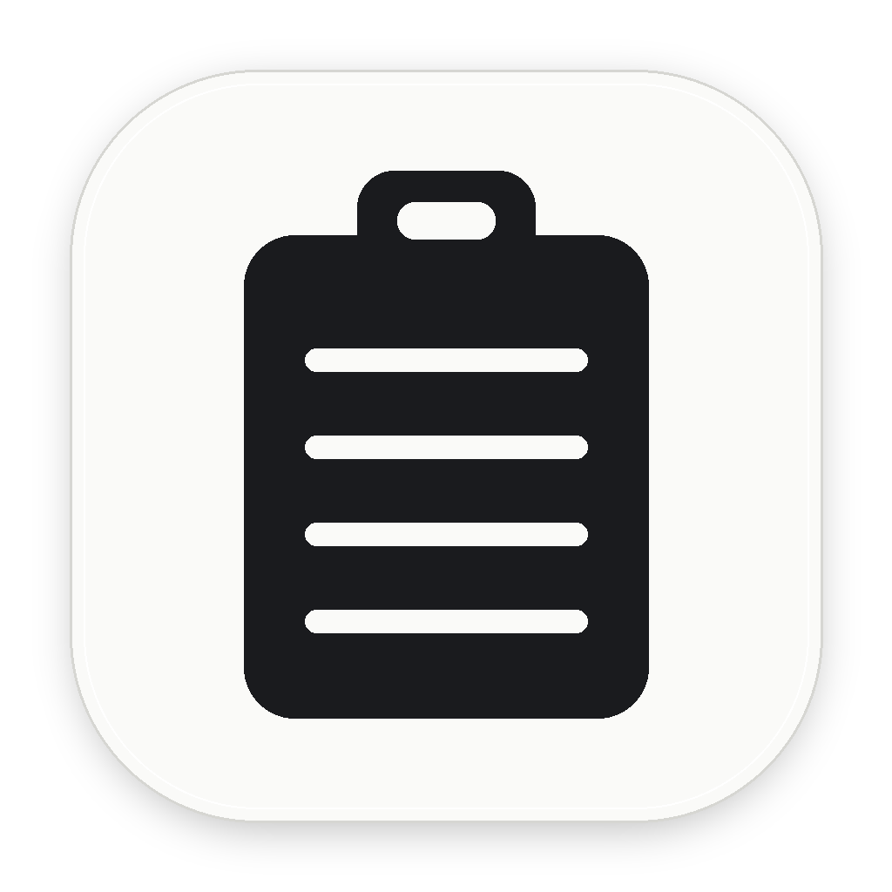

<p align="center">
  
</p>

<h1 align="center">workLog</h1>

<p align="center">悬浮球计时 · 本地工作记录 · 一键生成日报 / 周报 / 月报</p>

<p align="center">
  <a href="https://github.com/YangYuhua122121/WorkLog/actions/workflows/ci.yml"></a>
  <a href="https://github.com/YangYuhua122121/WorkLog/releases"></a>
  <a href="LICENSE"></a>
</p>

workLog 是一个 macOS / Windows 桌面端工作记录工具。它常驻一个悬浮球，选好项目-任务后开始 / 停止计时，数据只存在本地 SQLite；需要写日报、周报、月报时，按模板渲染或调用你自己配置的 OpenAI 兼容接口生成。

## 功能

- **悬浮球常驻**：点击展开主面板，拖动移动，跟随系统主题；
- **项目 - 任务**：项目号 / 任务号自动编号，支持优先级、DDL、备注和自定义字段；
- **计时与阶段**：开始 / 停止计时，每次停止生成一个阶段号，填写阶段成果与下一目标；
- **防遗忘**：正常工作时间之外连续计时超过 x 分钟弹出提醒，y 秒无操作自动停止；
- **数据管理**：按项目名 / 优先级筛选，DDL 三态排序，详情编辑、阶段切换、导出 CSV / Excel、打开数据库目录；
- **统计看板**：当日 / 本周 / 本月 / 上周 / 上月，甘特与扇形图；周 / 月按「项目 × 天」聚合，甘特条上不标任务名，悬浮查看当天各任务时长；
- **报告**：`report-template.yaml` 定结构，`report-skill.md` 定文风；可复制模板报告，也可调用 OpenAI 兼容接口做 AI 改写；
- **本地优先**：无账号、无云端同步；只有在你点击 AI 增强时才会把选定周期的数据发给你配置的模型服务。

## 下载安装

前往 [Releases](https://github.com/YangYuhua122121/WorkLog/releases/latest)：

| 平台 | 安装包 |
| --- | --- |
| macOS（Apple Silicon / Intel） | [`workLog_0.2.7_universal.dmg`](https://github.com/YangYuhua122121/WorkLog/releases/download/v0.2.7/workLog_0.2.7_universal.dmg) |
| Windows 10 / 11 | [`workLog_0.2.7_x64-setup.exe`](https://github.com/YangYuhua122121/WorkLog/releases/download/v0.2.7/workLog_0.2.7_x64-setup.exe) |

> 目前安装包未签名 / 未公证：macOS 首次打开请右键 App →「打开」；Windows SmartScreen 选择「更多信息 → 仍要运行」。Windows 版使用系统 WebView2 Runtime，安装前请确认系统已安装 WebView2。

如果 Windows 安装后打不开，可查看启动日志：

```text
%APPDATA%\com.worklog.desktop\startup.log
```

macOS 对应：

```text
~/Library/Logs/workLog/startup.log
```

## 使用

1. 启动后屏幕顶部会出现悬浮球；
2. 点击悬浮球展开主面板，在「任务」页新建或选择项目-任务；
3. 点击悬浮球上的启停按钮开始计时；再次点击停止，填写本次阶段记录；
4. 「汇总」页选择周期，查看看板与报告。

### 快捷键 / 交互

- 单击悬浮球空白区：展开 / 收起主面板；
- 按住悬浮球移动：拖动整个窗口；
- 主面板展开后，按住顶栏空白处或表格空白处：拖动整个窗口；
- 右键悬浮球：展开 / 收起面板、开始 / 停止计时、打开设置、打开数据目录、隐藏到托盘、退出；
- 双击数据行 / 对已选行再次单击：打开详情；
- 右键数据行：导出 CSV / Excel、打开数据库目录、删除任务。

## 数据与隐私

所有数据保存在本机用户目录：

| 平台 | 路径 |
| --- | --- |
| macOS | `~/Library/Application Support/com.worklog.desktop/` |
| Windows | `%APPDATA%\com.worklog.desktop\` |

包含：

```text
worklog.db             SQLite 数据库
config.toml            外观 / 上下班时间 / LLM / 自定义字段
config/report-*.yaml   报告模板
config/report-*.md     报告撰写 Skill
timer-state.json       运行中计时 / 待保存阶段（重启恢复）
```

- API Key 目前按首版方案明文存在 `config.toml`，请勿把该文件提交到公开仓库；
- AI 增强只在点击按钮时联网，调用的是你自己填写的 Base URL / Key / 模型；
- 项目不收集任何遥测。

## 开发

前置：Node 18+、Rust 1.77+、对应平台的 Tauri 依赖（macOS 需 Xcode Command Line Tools）。

```bash
npm install
npm run dev        # 开发模式（会编译 Rust）
npm run build      # 打包当前平台安装包
```

只查看界面（浏览器内存数据，不落盘）：

```bash
npx serve src
# 打开 src/index.html
```

检查与测试：

```bash
npm run check:js
npm run test:rust
```

## 项目结构

```text
src/                    前端（原生 HTML/CSS/JS）
  clip.html / clip.js   悬浮球窗口
  index.html / app.js   主面板窗口
  styles.css            高保真原型样式 + 双窗口适配
src-tauri/              Rust / Tauri 2
  src/timer.rs          计时服务 + 防遗忘看门狗 + 状态恢复
  src/stats.rs          周期聚合、甘特 / 扇形数据
  src/report.rs         模板渲染 + LLM 改写
  src/export.rs         Excel / CSV 导出
  src/db/               SQLite
resources/              随包报告模板与 Skill
原型图/                 高保真原型（开发基准）
配置/                   便于评审的报告配置副本
worklog-PRD文档.md      产品需求
worklog-技术方案.md     技术方案
开发说明.md             开发与打包说明
```

技术栈：Tauri 2 · Rust · SQLite（rusqlite）· 原生 HTML/CSS/JS。

## 已知限制

- macOS 使用原生 child window 让主面板零延迟跟随悬浮球；Windows 使用位置同步，单线程按 ~60Hz 取最新位置；
- Windows 主面板窗口不透明，展开 / 收起由 Rust 移动窗口完成（从屏幕上方滑入），因此不会出现“整块面板突然出现”；macOS / Linux 使用 CSS 下滑；
- Windows 上悬浮球与主面板都在 topmost 组内，通过 `SetWindowPos` 调整相对层级保证悬浮球在上；点击主面板后会自动重新压回；
- 报告导出目前只写系统「下载」目录并在文件管理器中定位，暂未弹保存对话框；
- 安装包未签名 / 未公证；
- 欢迎通过 Issue 反馈 macOS / Windows 的具体环境与复现步骤。

## License

[MIT](LICENSE)
