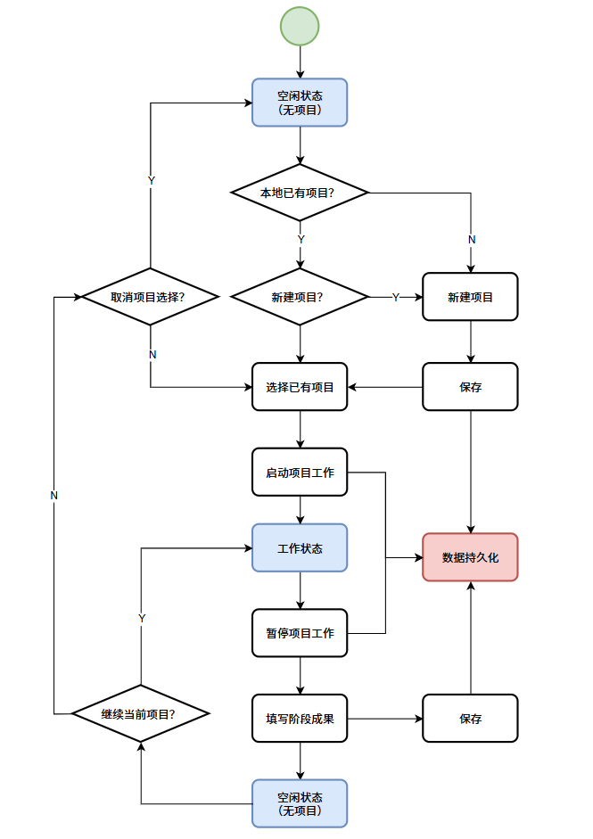
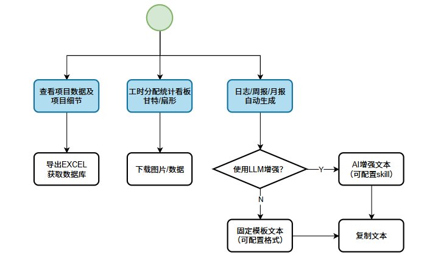
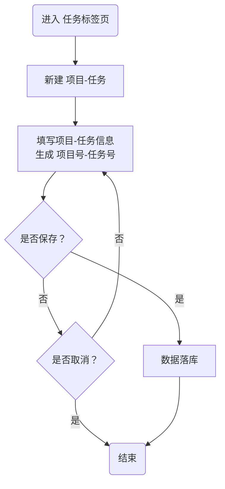
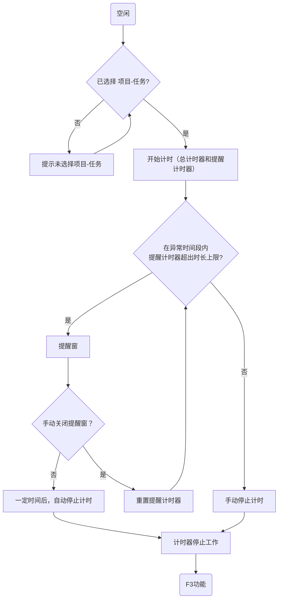
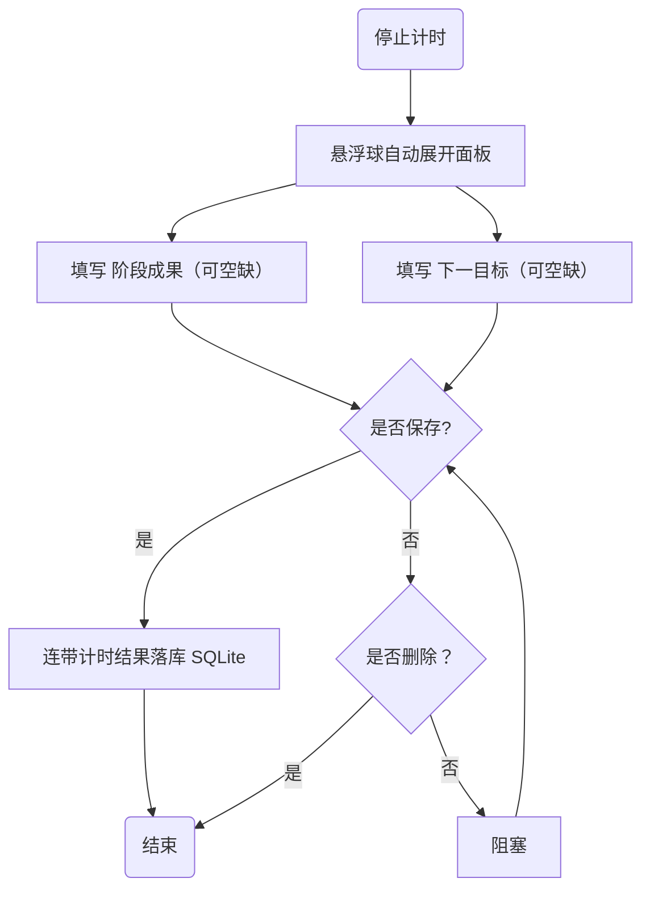
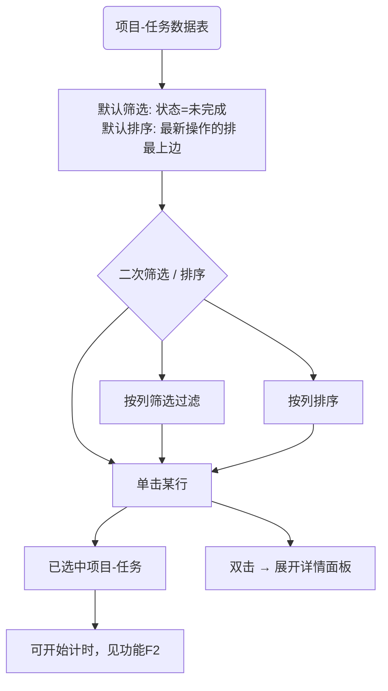
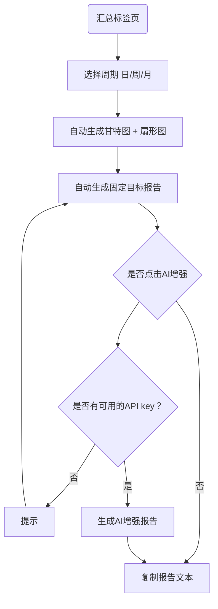

# workLog

***

文档信息：workLog 基本产品设计文档

文档版本：v0.23

创建时间：2026-10-13

状态：草稿 2（需求概述已完成）

编写人：杨与桦

编写完成日期：

评审人：

评审完成日期：

***

# 文档版本历史

| edition | date       | writer | content                                                                                                                                                                                                                    |
| ------- | ---------- | ------ | -------------------------------------------------------------------------------------------------------------------------------------------------------------------------------------------------------------------------- |
| v0      | 2026-10-13 | 杨与桦 | 新建基本产品设计文档                                                                                                                                                                                                       |
| v0.1    | 2026-10-14 | 杨与桦 | 补充需求概述章节；确定产品形态（悬浮球常驻计时）与技术选型讨论结论                                                                                                                                                         |
| v0.2    | 2026-10-14 | 杨与桦 | 补充产品描述章节（名词解释、整体流程图、功能清单）                                                                                                                                                                         |
| v0.3    | 2026-10-16 | 杨与桦 | 补充功能需求章节（F1-F6）；新增待办功能并入记录与待办中心（F4）；补充项目 - 任务字段说明                                                                                                                                   |
| v0.4    | 2026-10-17 | 杨与桦 | 产品整体流程拆分为两条业务主线（项目 - 任务记录 / 统计与日志输出）；功能清单分两组；功能需求补齐验收标准                                                                                                                   |
| v0.5    | 2026-10-17 | 杨与桦 | 依据「数据统计与日志导出」流程图更新文字描述、功能清单第二组及 F5/F6 功能需求                                                                                                                                              |
| v0.6    | 2026-10-18 | 杨与桦 | 联合主键调整为【项目号-任务号-阶段号】；F1 默认字段扩充并支持自定义；F2 改为开始/停止两态（去暂停/快捷键）；F3 下一目标自动预输入；F4 改为项目-任务数据表；F5 归组按自然周/月起点                                          |
| v0.7    | 2026-10-18 | 杨与桦 | 功能需求章节重构：每个功能小节统一按「场景描述 / 流程图 / 原型（文字线框）/ 详细描述 / 验收标准」组织撰写                                                                                                                  |
| v0.8    | 2026-10-18 | 杨与桦 | 补充并整理「页面原型」章节文字；基于该章节制作可交互 HTML 原型（记事板风格）                                                                                                                                               |
| v0.9    | 2026-10-18 | 杨与桦 | 原型改为低保真黑白线框；按钮纯图标（齿轮）；主面板固定纵向 A4 尺寸；表格可滚动并新增项目名筛选；选中改为固定位置滚动（非重排）；双击打开详情；上滑面板底边平齐；汇总页隐去新建按钮                                         |
| v0.10   | 2026-10-18 | 杨与桦 | 修复双击不触发面板的 bug（单击不再重建 DOM）；交互改为：单击仅选中，双击才滚动至表头并打开详情面板                                                                                                                         |
| v0.11   | 2026-10-18 | 杨与桦 | 修复选中行被右移（改用首格 inset 色条）；设置面板顶端改为紧贴标签栏下方；停止计时时当前项目行推至顶端并展开详情                                                                                                            |
| v0.12   | 2026-10-18 | 杨与桦 | 加宽计时态悬浮块、改善上下间距；新增：关闭面板后数据表自动归位（底部仅留一行空行）、点击面板外部即关闭、再次点击新建/设置按钮即关闭                                                                                        |
| v0.13   | 2026-10-18 | 杨与桦 | 悬浮块改为单行（计时态横向加宽并平滑过渡）；外部点击只关闭、不触发底层；关闭后复原原滚动位置；常规滚动上限为底部两个空行                                                                                                   |
| v0.14   | 2026-10-18 | 杨与桦 | 悬浮块改为两行（按钮/状态/时分一行，项目任务一行），宽度随内容自适应；时间仅显示时分，秒用底边 60 秒进度细线；外部点击拦截 mousedown，修复筛选下拉仍被触发                                                                 |
| v0.15   | 2026-10-18 | 杨与桦 | 计时中锁定项目（禁止切换计时对象）；秒的表达改为「工作中」后三个圆点依次闪烁（移除 60 秒进度细线）                                                                                                                         |
| v0.16   | 2026-10-18 | 杨与桦 | 初始态仅显示悬浮块；点击夹子空白区平滑展开/收起主面板；长按可拖动整个单元（鼠标+触摸）                                                                                                                                     |
| v0.17   | 2026-10-18 | 杨与桦 | 拖动改为按下不释放并移动即触发（去除长按等待）；点击（按下后松开、未移动）展开/收起                                                                                                                                        |
| v0.18   | 2026-10-19 | 杨与桦 | 计时中允许双击本项目查看详情；停止计时后悬浮块恢复紧凑尺寸；presentDetail 兜底打开已收起的板子                                                                                                                             |
| v0.19   | 2026-10-19 | 杨与桦 | 删去筛选行，数据默认最新在前；筛选/排序收纳到字段栏（项目名/优先级/状态筛选，DDL 三态排序）；新建改为顶部空白行、仅保存；停止后阶段记录改为模态、必须手动保存                                                              |
| v0.20   | 2026-10-19 | 杨与桦 | 功能清单对齐 F1–F5（F5/F6 合并）；各功能补验收标准；统一状态列、术语（下一目标）、周期按钮（5 个）、编号起点（从 1）；数据模型确认为维度表+阶段明细表                                                                      |
| v0.21   | 2026-10-20 | 杨与桦 | 数据表移除「状态」列与状态筛选（状态仅作为任务属性与选中行左侧色条保留）；汇总页看板去掉下载图片 / 导出数据，报告仅保留复制；扇形图去掉项目内虚线划分，悬浮浮窗改为直接列举该项目下各任务占总时长的比例；同步低保真原型 v2 |
| v0.22   | 2026-10-20 | 杨与桦 | 新增高保真原型（macOS 毛玻璃风格），低保真原型 v1/v2 保留；面板展开期间冻结数据表滚动；详情面板允许直接切换阶段（切换不丢内容，取消回滚）；提示窗改为 2s；当日甘特图横轴取当天第一个任务开始到最后一个任务结束；甘特条块悬浮改为即时浮窗并显示时间区间与时长；主面板顶部去掉两条分隔线 |
| v0.23   | 2026-10-20 | 杨与桦 | 上滑面板改实色并加「深色标题栏 / 底栏」，与主面板拉开层级；悬浮球提亮；F3 阶段详情底部新增「需填写内容」闪烁带；P9 提醒窗去掉「立即停止」只保留红色「仍在工作」；新增深色 / 浅色 / 跟随系统外观设置，浅色主题按同一套层级与 1px 规则镜像实现 |

# 需求概述

### 产品概述及目标

**背景**：日常工作中，项目与任务的投入时间分散、缺乏可靠的记录手段，导致写日报、周报和月度工作复盘时需要回忆与手工整理，效率低且数据不准。

**产品定位**：workLog 是一款跨平台（macOS / Windows）桌面端工作记录工具，以常驻悬浮球为交互载体，核心链路为：选择项目与任务 → 启动计时（开始 / 停止） → 结束计时并落库。基于本地积累的结构化计时数据，通过大语言模型（LLM）一键生成日报、周报与月报。

**目标与价值点**：

1. **低成本记录**：计时操作收敛在悬浮球上完成，不打断工作流；

2. **数据可信**：时长由计时器客观产生，杜绝日报靠回忆；

3. **报告提效**：日报 / 周报 / 月报由 LLM 基于真实统计数据自动撰写，用户仅需一键生成与复制；

4. **数据私有**：工作数据仅存本地 SQLite，是否上传由用户自行配置的 LLM 服务决定。

### 文档阅读对象

| 阅读对象      | 职责与关注点                                                 |
| ------------- | ------------------------------------------------------------ |
| 产品 / 编写人 | 需求定义、优先级判断、验收标准确认                           |
| 开发人员      | 理解产品全貌、数据模型与功能细节，据此拆解任务与排期         |
| 评审人员      | 评审需求合理性、完整性与可行性，评审后对风险条款进行确认周知 |

### 运营环境

| 环境项   | 说明                                                          |
| -------- | ------------------------------------------------------------- |
| 客户端   | macOS 12+ / Windows 10+，桌面端，支持悬浮球常驻、系统托盘     |
| LLM 服务 | 用户自行配置的 OpenAI 兼容接口，云端调用                      |
| 网络     | 仅报告生成时需要联网（调用 LLM 接口），日常计时与统计完全离线 |
| 运行形态 | 单机单用户，无账号体系、无多端同步                            |

### 产品风险

| #   | 风险项                      | 影响与应对                                                                                                      |
| --- | --------------------------- | --------------------------------------------------------------------------------------------------------------- |
| 1   | 工作数据经 LLM 接口上传云端 | 存在隐私顾虑；应对：仅上传用户选定范围的统计数据、发送前明确提示，且 LLM 服务完全由用户自行配置                 |
| 2   | API Key 存储安全            | 首版明文存于本地配置文件，存在泄露风险；后续版本迁移至系统钥匙串 / 凭据管理器                                   |
| 3   | 悬浮球技术可行性            | 透明置顶窗口在 macOS/Windows 存在已知差异（全屏覆盖、边缘渲染）；已验证 Tauri 2 能力，需在开发期实测两平台表现  |
| 4   | 产品交互形态未定            | 悬浮球展开形式、是否保留主窗口尚待讨论确定；应对：开发按 “数据层与计时核心先行、UI 层可替换” 推进，控制返工风险 |
| 5   | LLM 生成质量不稳定          | 报告可能不符合预期；应对：内置报告模板约束输出格式，支持重试与人工编辑                                          |
| 6   | 忘记停止计时                | 产生虚高时长；应对：单次计时上限 + 到限提醒与自动停止机制                                                       |
| 7   | Windows WebView2 运行时依赖 | 个别机器可能未安装；应对：安装包检测并引导安装                                                                  |

# 产品描述

### 名词解释

| 术语                    | 说明                                                                                                                                     |
| ----------------------- | ---------------------------------------------------------------------------------------------------------------------------------------- |
| 项目（Project）         | 一项独立工作的集合，每个项目拥有唯一「项目号」，如 P001                                                                                  |
| 任务（Task）            | 项目下的具体工作事项，在项目内拥有唯一「任务号」，如 T01                                                                                 |
| 项目 - 任务（维度）     | 一项独立工作；以「项目号 - 任务号」唯一标识，含 DDL、优先级、状态等属性                                                                  |
| 阶段（明细 / 联合主键） | 一次「开始计时 → 停止计时」的独立计时区间，阶段号在该项目 - 任务内自动递增（第 1 次计时 = 阶段 1）；含起止时间、时长、阶段成果与下一目标 |
| 归档                    | 项目或任务已完成、不再计时，但历史记录保留可查                                                                                           |
| 悬浮球                  | 常驻桌面、全局置顶的计时交互载体，支持收起 / 展开                                                                                        |
| 日报 / 周报 / 月报      | 按日 / 周 / 月聚合工时并组织成文的汇报产物                                                                                               |
| LLM 报告                | 调用用户自配的 OpenAI 兼容接口，基于统计自动撰写的文字报告                                                                               |

### 产品整体流程

产品整体流程分为两条业务主线：先「项目 - 任务记录」（工时记录），再基于记录数据「统计与日志输出」。

**1. 项目 - 任务记录业务流程（工时记录）**

用户从空闲状态进入：判断本地是否已有项目 → 新建或选择项目 → 启动项目工作 → 填写阶段成果 → 保存落库 → 回到空闲；期间可继续当前项目或取消项目选择后再选项目。具体流转以流程图为准：

**2. 数据统计与日志导出流程**

基于已落库的工作记录数据，并行提供三条能力：查看项目数据及项目细节并导出 Excel / 获取数据库 → 工时分配统计看板（甘特 / 扇形） → 日志 / 周报 / 月报自动生成（固定模板文本（可配置格式）或 AI 增强文本（可配置 skill））并复制文本。具体流转以流程图为准：

### 功能清单

功能清单按两大业务流程拆分为两组，与「产品整体流程」一一对应。

**第一组・工时记录类（对应「项目 - 任务记录业务流程」）**

| 编号 | 功能                | 说明                                                                                                                                                                                              |
| ---- | ------------------- | ------------------------------------------------------------------------------------------------------------------------------------------------------------------------------------------------- |
| F1   | 项目 - 任务新建     | 新建、历史复用（项目名下拉选择）、自动编号【项目号】-【任务号】（项目、任务分别自增，任务在各项目内独立计数）；填写默认信息，支持在设置中自定义字段；新建从数据表顶部新增空白行                   |
| F2   | 计时核心（悬浮球）  | 含总计时器与提醒计时器；选中任务后开始 / 停止，按秒累计并自动产生阶段号；异常时间段防遗忘（超时提醒窗、无操作倒计时自动停止），阈值与时段可配置                                                   |
| F3   | 工作成果记录        | 停止计时后自动模态弹出面板，填写 / 确认阶段成果、下一目标与任务状态；可留空，但必须手动「保存」或「删除记录」；下一目标自动作为下次阶段成果的预输入                                               |
| F4   | 项目 - 任务数据管理 | 数据表（查看器 + 计时对象选择）：默认仅显示未完成、按最近操作时间倒序；字段栏支持筛选（项目名 / 优先级）与排序（DDL）；单击选中、双击展开详情，支持编辑 / 删除，支持导出 Excel / CSV 与查看数据库 |

**第二组・统计输出类（对应「数据统计与日志导出流程」）**

> 说明：流程图第一分支「查看项目数据及项目细节 → 导出 Excel / 获取数据库」由 F4 的数据查看与导出能力承接。

| 编号 | 功能                       | 说明                                                                                                                                                      |
| ---- | -------------------------- | --------------------------------------------------------------------------------------------------------------------------------------------------------- |
| F5   | 工时分配统计看板与报告生成 | 选择周期（当日 / 本周 / 本月 / 上周 / 上月），生成甘特图 + 扇形图；按固定模板生成报告，可点 AI 重写（自配 OpenAI 兼容接口，无配置则提示并回退），支持复制 |

# 功能需求

### F1 项目 - 任务新建

**1. 场景描述**

用户新建项目，以将项目信息记录在数据库中，用于后续其他功能

新建项目-任务时会要求默认填写部分信息，用户也可在设置中新增需要填写的信息项

**2. 流程图**

**3. 原型与交互**

引用P3主面板、P7新建项目页面作为该业务功能的原型

- P3主面板点击新建按钮，P7上滑面板滑出，用户可填写相关项目信息，然后可点击保存或取消。若直接关闭面板，再次点击新建按钮后，上次填写的数据会被保留。点击保存/取消才会清除P7中的内容

**4. 其他要点**

- 用户可在设置中增加可填写的信息项
- **项目-任务号：** 每次成功新建的项目 / 任务都会以自增顺序分别指定编号，项目号从 1 开始（如 P001），任务号在每个项目内从 1 开始独立计数（如 T01）；同一项目可通过项目名下拉直接复用

**5. 验收标准**

- 点击「新建」按钮后，在数据表**顶部新增一个空白行**并上滑 P7 面板；
- 保存后自动编号（项目号 - 任务号，任务在各项目内独立计数）并落库，新条目出现在数据表最上方；
- 项目名支持从已有项目下拉选择（复用项目），不产生重复项目；
- 面板未保存直接关闭（X）时保留已填内容，再次打开可继续；点击「保存」或「取消新建」才清空；
- 可在设置中新增 / 管理自定义填写字段。

### F2 计时核心（悬浮球）

**1. 场景描述**

用户需要在不停下手头工作的情况下，随时开始一段工作计时并在结束时停止；计时全程收敛在悬浮球上完成，不打断工作流。

会存在两个计时器，分别为总计时器和提醒计时器。总计时器用于记录项目-任务的工作时间并记录在数据库中；提醒计时器在异常时间段（主要是下班后的时间，可人为设置）启动，若下班后仍工作了一定时间（可设置），会自动停止计时，以避免出现忘记关闭计时器的情况造成数据记录异常

**2. 流程图**

**3. 原型与交互**

引用页面原型中的P5-1、P2、P9

- **基本使用：** 在P5-1的数据表中单击可选中项目，然后点击P2的计时按钮，即可开始计时，再次点击计时按钮可停止计时

- **防遗忘：** 在非正常时间段range，提醒计时器（隐式）将启动，若超出时长x上限，将自动弹出P9窗口，提示用户“是否忘记停止计时，将在y分钟后自动停止计时”。若用户手动关闭，则提醒计时器重新计时，若无操作，则总计时器自动关闭。此处的range、x、y均可在设置中设置

- **计时中锁定项目：**计时进行中禁止切换计时对象——单击其他数据行不改变选中，双击其他行不展开详情，均提示「计时中，无法切换项目」；但**允许双击本项目**查看其详细信息；

- **计时精度**：按秒累计；

**4. 其他要点**

- **阶段号：** 每次计时结束都会给当前项目 - 任务以自增方式指定一个阶段号，从 1 开始（第 1 次计时 = 阶段 1），不同项目 - 任务独立计数

**5. 验收标准**

- 已选中项目 - 任务后点击启停按钮开始计时，再次点击停止；未选择时给出提示；
- 仅「开始 / 停止」两态；计时中锁定项目——其他行单击 / 双击不改变计时对象并提示，双击本项目可查看详情；
- 异常时间段内，提醒计时器超出阈值时弹出 P9 提醒窗；手动关闭则重置提醒计时，无操作则倒计时 y 后自动停止并进入 F3；
- 计时按秒累计，每次计时产生一个自增阶段号（阶段 1、2…）；
- 异常时间段、阈值 x、倒计时 y 均可在设置中配置。

### F3 工作成果记录

**1. 场景描述**

停止计时后，软件自动弹出输入面板，要求用户记录本阶段的实际产出与尚未完成的内容，以便后续复盘与生成报告。

**2. 流程图**

**3. 原型与交互**

引用P5-3

- **自动展开（模态）**：停止计时后自动展开P5-3面板，并引导填写「阶段成果」、「下一目标」及任务完成状态，允许留空

- **必须手动操作**：阶段成果与下一目标均可留空，但**必须手动点击「保存」或删除**——面板为模态，关闭按钮和外部点击不关闭，操作前不能返回主面板、新建、设置或开始计时，若有相关操作均会弹出提示窗

**4. 验收标准**

- 停止计时后自动模态弹出 P5-3 面板，当前项目数据行被推至字段栏下方；
- 阶段成果、下一目标、任务状态可编辑，其余字段（含阶段列表）只读禁用；
- 字段可留空，但必须手动点击「保存」或「删除记录」；未处理前其他操作（返回 / 新建 / 设置 / 开始计时）均被拦截并提示；
- 点击「保存」：阶段成果、下一目标与本次计时结果一并落库；点击「删除记录」：丢弃本次阶段（不计入累计）；
- 上一阶段填写的「下一目标」自动预填到本次「阶段成果」。

### F4 项目 - 任务数据管理

**1. 场景描述**

本模块为一个数据表单，支持用户筛选过滤、排序，以查看、选择已经入库的项目-任务数据信息，用于计时、阅读、编辑和删除

**2. 流程图**

**3. 原型与交互**

引用P3、P5-1和P5-2

- **数据表：** 对应P5-1面板，基本形式为一个数据表，对于底层数据库，每行数据对应一组【项目-任务-阶段】，但此处会进行去重，每行数据对应一组【项目-任务】。展示的数据表仅仅包含项目名、任务名、ddl和优先级四个字段
- **排序与筛选：** 类似excel，项目名允许筛选、任务名无法操作、ddl允许排序、优先级允许筛选
- **点击交互：** 单击某行数据将视为选中项目 - 任务，并可开始对该项目计时（进入功能 F2）；**双击**（或对已选中行再次单击）则在选中基础上展开 P5-2 面板；两次单击与双击的效果一致。
- **编辑内容：**展开P5-2面板后可对项目内容进行编辑，点击保存则将修改写入数据库，点击取消则丢弃修改。关闭面板或其他操作仅在无修改时允许，触发相关操作时都会弹出提示

**4.其他要点**

- **数据模型（两张表，推荐）**：区分「项目 - 任务」维度表与「阶段」明细表 —— 项目 - 任务是统计与记录的核心维度，主键为【项目号 - 任务号】；阶段是每次独立计时（开始 → 停止）的明细，主键为【项目号 - 任务号 - 阶段号】，通过外键关联。前端按维度表去重展示，底层按明细表记录。**采用两张表更合理**：维度字段（状态 / 优先级 / 截止日期等）只存一次，阶段明细随每次计时追加，避免冗余与不一致。
- **前端页面展示默认筛选和排序方式：** 只展示状态为「未完成」的项，默认按最近操作时间倒序（最新在上）；
- **底层数据库字段说明（默认字段）**：

| 字段              | 类型     | 说明                                                   |
| ----------------- | -------- | ------------------------------------------------------ |
| 项目号            | INT      | 项目唯一编号，自动从 1 递增                            |
| 任务号            | INT      | 项目内唯一编号，自动从 1 递增                          |
| 项目名            | TEXT     | 项目名称，如「交通仿真平台二期」                       |
| 任务名            | TEXT     | 任务名称，如「轨迹数据处理」                           |
| 状态              | ENUM     | 未完成 / 已完成                                        |
| 优先级            | ENUM     | 高 / 中 / 低                                           |
| 截止日期          | DATE     | 项目 / 任务的计划截止时间                              |
| DDL               | INT      | 距离截止时间还剩几天，由截止日期每日计算（可空）       |
| 项目-任务创建时间 | DATETIME | 该项目 - 任务条目首次创建时间                          |
| 最近操作时间      | DATETIME | 最近一次操作（新建 / 计时 / 修改）的时间，用于默认排序 |
| 累计时长          | INT      | 由关联阶段记录聚合得出（秒），非手工录入               |
| 阶段号            | INT      | 该项目 - 任务内的阶段自增序号（第 1 次计时 = 阶段 1）  |
| 阶段计时起点      | DATETIME | 本次开始计时时间                                       |
| 阶段计时终点      | DATETIME | 本次停止计时时间                                       |
| 阶段成果          | TEXT     | 本阶段计时结束时的产出                                 |
| 下一目标          | TEXT     | 本阶段尚未完成的内容，将作为下一阶段成果的预输入       |
| 备注              | TEXT     |                                                        |

> 以上为默认字段；用户可在「设置」中自定义新增字段，以增加项目记录的信息丰富度。

**5. 验收标准**

- 数据表默认仅显示「未完成」项，按最近操作时间倒序（最新在最上）；
- 数据表列为：项目名、任务名、DDL、优先级；字段栏支持项目名 / 优先级筛选，DDL 三态排序（未排序→升序→降序→未排序）；
- 单击某行仅选中（左侧色条高亮）；双击 / 两次单击在选中基础上将该行滚动至表头并上滑 P5-2 详情；
- 详情面板可编辑，保存写入数据库、取消丢弃；有改动时关闭面板或其他操作被拦截并提示；
- 底层为维度表 + 阶段明细表两张表，前端按维度去重；
- 支持导出 Excel / CSV，并提供直接查看数据库的入口。

### F5 工时分配统计看板与报告生成

**1. 场景描述**

用户需要从宏观上了解各项目、任务在不同周期内的工时投入分布；另外还需要快速得到可提交的日报 / 周报 / 月报，而不是手工回忆整理。

**2. 流程图**

**3. 原型（文字线框）**

引用P6的原型图。

- **汇总周期：** 可选择当日 / 本周 / 本月 / 上周 / 上月（5 个排他按钮，默认当日）。根据选择的周期不同，数据看板和报告将使用不同周期的数据进行汇总。
- **数据看板：** 数据看板包括甘特图和扇形图两种图表。甘特图可以展示具体各项目-任务的完成顺序（当日周期横轴取当天第一个任务的开始到最后一个任务的结束；条块悬浮即时显示时间区间与时长），扇形图可以展示具体各项目-任务的时间占比。图表形式具体见P6原型图
- **报告AI增强：**在报告生成模块处，自动生成的报告是基于固定格式化模板生成的。可以主动点击AI重写按钮来调用大模型进行报告撰写，若无可用API配置，则弹出提示并回退为固定格式化模板的报告 
- **报告复制：** 点击复制按钮可一键将报告复制到剪贴板，并弹出提示

**5. 验收标准**

- 汇总页提供 5 个排他周期按钮（当日 / 本周 / 本月 / 上周 / 上月），默认当日；切换后看板与报告按该周期数据重新聚合；
- 甘特图按周期生成（日周期横轴为时、周 / 月为日），条形显示任务名；当日周期的时间轴范围为当天第一个任务的开始时间到最后一个任务的结束时间；悬浮任务条块即时弹出时间区间与时长；扇形图按项目分组、展示百分比，悬浮扇形区域可查看该项目下各任务占总时长的比例；
- 周 / 月按自然周、自然月起点归组；
- 报告默认按固定模板生成；点击「AI 增强」可调用大模型重写，无 API 配置时提示并回退固定模板；
- 报告支持一键复制到剪贴板。

# 页面原型

## 基本风格

整体采用拟物化的「记事板」设计语言：模拟一块记事板的样貌，但以正常软件UI的风格呈现，而非写实风格。记事板的「夹子」由常驻悬浮球承担，软件主面板即记事板的「底板」。

### 视觉风格（高保真）

高保真原型采用「macOS 毛玻璃（Vibrancy）」风格，规则如下：

- **三级深度灰阶**：`#1c1c1e`（最深，页面底 / 表头 / 输入框）→ `#2c2c2e`（中间，主面板）→ `#3a3a3c`（表面，上滑面板 / 悬浮球 / 卡片）；
- **层级区分**：上滑面板用 `#3a3a3c` **实色**，标题栏与底栏再压一层 `rgba(28,28,30,.55)` 深色带，顶边为 1px 白色 16% 提亮 —— 形成「深框浅身」，与主面板 `#2c2c2e` 之间边界清晰；悬浮球底色提亮到 `rgba(58,58,60,.86)` + 1px 白色 14% 描边，落在页面或主面板上都能清晰浮起；
- **面板质感**：毛玻璃仅用于**浮层**（悬浮球、筛选 / 项目名下拉、悬浮浮窗、提醒窗、Toast）；上滑面板用实色，保证层级干净；
- **浅色主题**：所有颜色统一走 CSS 变量，`html[data-theme="light"]` 反转明度方向（页面 `#e8e8eb` → 主面板 `#f6f6f8` → 上滑面板 `#ffffff`），强调色改用浅色系统的 `#0071e3`；圆角、1px 分隔、字号分工与动效规则与深色完全一致；由「设置 · 外观」切换，默认深色，可选浅色 / 跟随系统（系统外观变化实时同步）；
- **1px 哲学**：所有分隔均为 1px 半透明边框（深色下白色 8%–16%，浅色下黑色 7%–18%），不使用粗边框、不使用渐变、不使用发光；
- **字体分工**：标题用衬线（Georgia / 宋体），正文用系统无衬线（-apple-system / 苹方），数字与时长用等宽（SF Mono / Menlo）；
- **文字层级**：主要 white/95、次要 white/70、弱化 white/40（浅色主题对应黑 88% / 58% / 40%）；
- **交互反馈**：hover 仅轻微提亮背景（white/5 → white/12，浅色下为黑 3.5% → 10%），过渡只作用于颜色（200ms ease-out）；无位移、无缩放、无装饰性动画；
- **强调色**：深色下系统蓝 `#0a84ff`、浅色下 `#0071e3`，仅用于文字高亮、选中色条与标签下划线；保存 / 取消按钮用同色系浅底 + 同色系文字（深色为深底 + 亮字，浅色为浅底 + 深字），不使用高亮实心块；
- **圆角**：最大 12px（rounded-xl）；正圆仅用于状态点等图标级元素（计时按钮内圆点、秒点），不用于容器；
- **功能性动效保留**：面板上滑、暂停/计时过渡、秒点闪烁与「必填提示」闪烁属于功能反馈，予以保留；除此之外不做装饰性动画，并提供 `prefers-reduced-motion` 降级。

### 原型文件

| 文件 | 风格 | 说明 |
| --- | --- | --- |
| `原型图/WorkLog页面原型.html` | 低保真黑白线框 | 初版原型（v1），保留备查 |
| `原型图/WorkLog页面原型-v2.html` | 低保真黑白线框 | 按 PRD v0.21 对齐的低保真原型（v2） |
| `原型图/WorkLog页面原型-高保真.html` | macOS 毛玻璃 | 高保真原型，交互与低保真 v2 一致，内置深色 / 浅色 / 跟随系统三套外观，后续改动以此文件为准 |

## P1初始态与展开 / 收起

- **初始态**：软件启动后仅显示悬浮块（夹子），主面板（板子）隐藏；
- **点击展开 / 收起**：点击悬浮块的**空白区（非启停按钮）**，主面板由夹子位置平滑展开（板子从夹子下伸出，板子上边缘与夹子中部重叠）；再次点击悬浮块则平滑收起；
- **收起联动**：收起时一并关闭所有上滑面板；
- **拖动**：在悬浮块上**按下不释放并移动**，即拖动整个「夹子 + 板子」单元在屏幕上的位置；按下后直接松开（未移动，即点击）则触发展开 / 收起；
- 展开 / 收起与拖动均支持鼠标与触摸。

## P2悬浮球

悬浮球是软件的基本入口，为一个圆角矩形，宽度随当前【项目 - 任务】宽度自适应。

- **空闲态**：仅一行，显示启停按钮与「空闲」，宽度紧凑；
- **计时态**：展开为两行——
  - 第一行：启停按钮 + 「工作中」+ 计时（仅显示**时 : 分**，如 00:00）；
  - 第二行：当前【项目 - 任务】；
- **秒的表达**：不显示秒数字，以「**工作中**」后**三个英文句点依次闪烁**（追逐式明暗，循环）表示正在走动，一秒钟进行一次闪烁；
- **计时中锁定项目**：计时进行中，单击其他行 / 双击其他行均不改变计时对象（提示「计时中，无法切换项目」）；但**允许再次单击本项目**查看详情；
- **停止后恢复紧凑**：停止计时后，悬浮块收起项目任务行、恢复空闲时的紧凑尺寸；
- 启停按钮内圆点由圆形平滑变为方形；空闲↔计时的宽度、高度与圆点变化均以平滑过渡呈现。

## P3主面板

- **固定尺寸**：主面板采用纵向 A4 长宽比（1 : 1.414），尺寸固定不随内容伸缩；
- 主面板上边缘位于悬浮球中央水平线位置；
- 顶栏左右两侧分别为「新建项目 - 任务」与「设置」两个**纯图标按钮**（无文字）：新建为「＋」，设置为齿轮。没有实体按钮，但周边一定范围的缓冲区都能触发该按钮；
- 主面板顶部**不设装饰性分隔线**：顶栏（图标行）与下方标签栏之间不画横线，避免顶部出现多条浅灰线；
- 悬浮球下方为两栏标签项：「任务」与「汇总」；
- 两个标签页共用同一固定尺寸区域，切换时面板大小不变。

## P4上滑面板（统一交互）

项目详情、新建项目、设置均以「上滑面板」呈现，统一遵循：

- **点击外部关闭**：面板出现后，点击剩余主面板的任意位置（面板、按钮以外）即关闭；此时该点击**仅用于关闭**，不会触发底层任何选项（筛选下拉、过滤、选中、排序、切标签等均不生效，含下拉框在按下瞬间展开）；
- **关闭按钮关闭**：上滑面板右上方有x，用于关闭
- **关闭后数据表复原**：关闭面板时，数据表滑动**复原到打开面板之前的滚动位置**（而非默认位置），这个特性与项目详情、新建项目面板有关，因为这两个上滑面板均会对数据表进行滚动。
- **面板展开期间冻结数据表**：面板上滑展开时，主面板数据表**不可再滚动**（滚轮 / 触摸滑动均被拦截），避免下方数据行移动到面板底下、造成"遮挡关系"错乱；面板关闭后恢复正常滚动。

## P5任务标签页

任务标签页包含「数据表」与「项目信息查看」两种情形：

### P5-1数据表

- 采用类数据表样式，表格区域固定高度，可**滚轮纵向滚动**查看更多数据；
- **不再设置独立筛选行**；数据**默认按最近操作时间顺序显示、最上方为最新**（倒序）；
- **字段**：项目名、任务名、DDL、优先级；
- **筛选 / 排序功能统一收纳在字段栏（表头）字段名后方**：
  - **项目名**：仅支持筛选——字段名后跟一个V符号，点击展开下拉列表（含「全部」+ 各项目名，**默认按 A-Z 排序**）；
  - **任务名**：不挂任何筛选 / 排序功能；
  - **DDL**：支持排序——点击在「未排序 → 升序 → 降序 → 未排序」三态循环，点第三次恢复未排序原貌（箭头标识↕️/ ↑/↓/↕️）；
  - **优先级**：仅支持筛选（V，全部 / 高 / 中 / 低）；
  - 使用筛选/排序功能时，对应字段区域被高亮
- 数据行下方保留若干空白行（类似电子表格，提供滚动区间）；**常规浏览时最多滚动到「底部两个空行」**，不会继续滚到整页空白，上滑面板弹出时视情况变动（空白区域会被上滑面板遮住）。

### P5-2项目信息查看

- **单击某行**：仅选中该行——该行高亮标出，最左侧显示一条状态色长条，长条高度与数据行高度一致；不滚动、不展开；

- **再次单击/双击某行**：再次单击指连续两次单击，这与双击是等价的。将该行在固定位置滚动至「与字段栏（表头）接触」的位置（即该行成为表头下方的当前行，不重新排序、不改变数据顺序），同时上滑「项目详细信息」面板；

- 面板上边缘位于「字段栏 + 第一行」之下，不遮挡表头与当前选中行，此时只有选中行可见，用以表示当前选择对象；

- 面板用于查看与修改选中条目的相关信息，包含的项包括：

  - 项目名（必填，有下拉列表，以选择已有项目）
  - 任务名
  - 截止日期（可选填，空缺时计算DDL时，DDL也空缺）
  - 优先级（必填，合并的联排三按钮，高中低，点击后显示对应颜色）
  - 备注（选填）
  - 其他在设置中用户自定义的字段
  - 阶段列表，为一个内嵌的表格，是项目-任务在阶段维度的扩展。表格包含阶段号、日期、成果三列。列表可点选；**点选其他阶段时可直接切换，不受"有未保存修改"限制**——切换前先把当前阶段已填写的内容保留在本次编辑中（不落库），切换回来后内容仍在，保存 / 取消按钮保持可用；点击「取消修改」则本次所有阶段编辑一并回滚到打开面板时的状态
  - 阶段详情区。点选阶段列表后，阶段详情区的数据变为指定阶段的详细数据，包括：
    - 阶段号（自动，不可修改）
    - 本次时长（自动，不可修改）
    - 阶段成果（单行输入框）
    - 下一目标（单行输入框）
    - 任务状态（后跟一体的的已完成/未完成按钮）

- 面板底部与主面板底部平齐，无镂空；面板右底部为「保存」按钮，左底部为「取消修改」按钮，两按钮仅有改动时启用，正常禁用，启用时颜色要明显，保存建议用类似绿色的颜色，取消修改建议用类似红色的颜色，右上为「关闭（收回）」按钮。

### P5-3停止计时后的「本次阶段记录」（模态）

- **停止计时后自动弹出**：当前项目数据行被推至字段栏下方，上滑「本次阶段记录」面板（F3），遮住其他数据，仅保留当前数据行；

- 面板信息与P5-2一致，但除了以下内容，其他均不允许修改且禁用，包括阶段列表。会自动聚焦到【阶段详情区】，区域底部闪烁示意需要填写，包括内容：

  - 阶段号（自动，不可修改）
  - 本次时长（自动，不可修改）
  - 阶段成果（单行输入框）
  - 下一目标（单行输入框）
  - 任务状态（后跟一体的已完成/未完成按钮，默认未完成）

- **必须手动点击「保存」或「删除记录」**：阶段成果与下一目标均**可留空**，但必须点击保存，期间不能进行其他任何操作（返回主面板、切标签、新建、设置、开始计时）；
- **底部闪烁提示带**：阶段详情区最底部有一条**缓慢明暗**的提示带（2.4s 循环；`prefers-reduced-motion` 下为静态），文案为两行 ——「本阶段需填写：**阶段成果** · **下一目标** · **任务状态**」/「三项均可留空，但必须手动点击『保存』或『删除记录』，否则不生成本阶段」；底栏同类说明改为静态小字，避免两处同时闪烁；

- 面板为模态，右上角无关闭按钮、外部点击不关闭；点击保存后恢复关闭按钮和关闭功能。

## P6汇总标签页

- 切换至汇总标签页时，**顶栏「新建项目 - 任务」按钮隐去**（仅保留设置）；
- 汇总标签页包含汇总周期按钮、「工时分配看板」（甘特 / 扇形）与「报告生成文字框」，纵向排列；
- 区域尺寸与任务标签页一致。
- 汇总周期按钮为五个排他按钮，合并到一起，分别支持当日/本周/本月/上周/上月，默认为当日
- 甘特图的横坐标为时间（日周期为时，周/月周期为日，并设置x-grid），纵坐标为项目，并以条状图显示各个项目所占时间，颗粒度为时/日，矩形条上显示任务名；
  - **当日周期的时间轴范围**：取当天**第一个任务的开始时间**到**最后一个任务的结束时间**，不使用固定的 0 时 / 24 时（例如 9:00 开始、19:30 结束，则横轴为 9:00 → 19:30）；
  - **条块悬浮浮窗**：鼠标悬浮到具体任务的条块上时，即时弹出浮窗（无延迟，样式与扇形图浮窗一致），内容为**时间区间与时长**（如「09:00 – 12:30 / 3.5h」），不使用浏览器原生 tooltip；
- 扇形图以项目进行分组，右侧展示图例及对应项目的百分比。不做项目内比例的二次划分（不使用虚线分隔）；鼠标悬浮至某项目的扇形区域上，即时弹出浮窗并直接列举该项目下每个任务的占比（均按总时长计，例如项目 A 占总时长 10%，下属两个任务各 5%）；
- 报告生成面板由「报告生成」小标题与右侧「AI 增强」按钮（同一行）、以及其下方的报告文字面板组成；文字面板右上方有一个复制图标（不提供导出按钮）

## P7新建项目页面

- 点击「新建项目 - 任务」按钮后，在数据表**最上方新增一个空白行**（最新数据位置），并上滑新面板；

- 上滑位置不遮挡字段栏与顶部的空白行；面板用于填写新建项目 - 任务的信息，可填写的项包括:

  - 项目名（必填，有下拉列表，以选择已有项目）
  - 任务名
  - 截止日期（可选填，空缺时计算DDL时，DDL也空缺）
  - 优先级（必填，合并的联排三按钮，高中低，点击后显示对应颜色）
  - 备注（选填）
  - 其他在设置中用户自定义的字段

- 面板底边与主面板底部平齐，无镂空；

- **底部有「取消新建」和「保存」按钮**，颜色与P5-2的保存按钮一直；右上角为关闭按钮。

## P8设置页面

- 点击「设置」按钮后，上滑一个新面板，包含软件的各类设置项；
- 面板顶端紧贴「任务 / 汇总」标签栏下方（位置高于详情 / 新建面板，可覆盖筛选区）；
- 面板底边与主面板底部平齐，无镂空。
- **外观**：面板顶部为「深色 / 浅色 / 跟随系统」三选一（分段控件，占满整行），切换**即时生效**并作用于全部界面；默认深色；选「跟随系统」时随系统外观实时切换；浅色主题沿用同一套圆角、1px 分隔与动效规则，只反转明度方向；

## P9 计时提醒窗口

类似主面板的弹出方式，但是提示性更强、面板较小，足够显示文字和按钮即可

- 正文：「检测到你可能忘记停止计时。若无操作，将在 **y** 秒后自动停止并生成本次阶段记录。」
- 底部**只保留一个按钮「仍在工作」**（红色系、占满整行）：点击后关闭提醒窗并重置提醒计时；
- **不提供「立即停止」**：人不在时由倒计时归零自动停止并进入 F3（无需人工干预）；人回来想立刻停止时，直接点悬浮球的启停按钮即可 —— 提醒窗遮罩只覆盖主面板，悬浮球仍可点击，停止后自动关闭提醒窗并弹出 F3。
- 遮罩仅作用于主面板，不拦截悬浮球。

## P10 一般提醒窗口

- 在主面板中央显示，持续2s后消失
