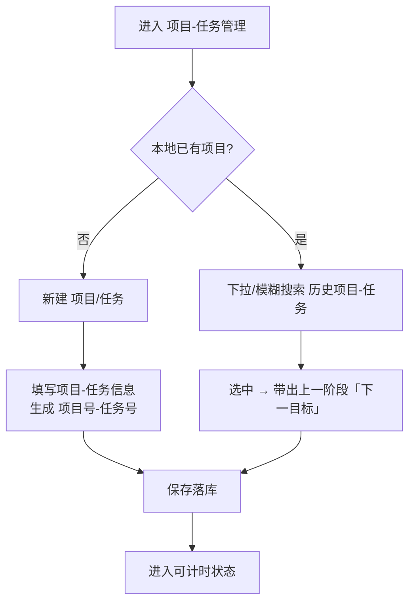
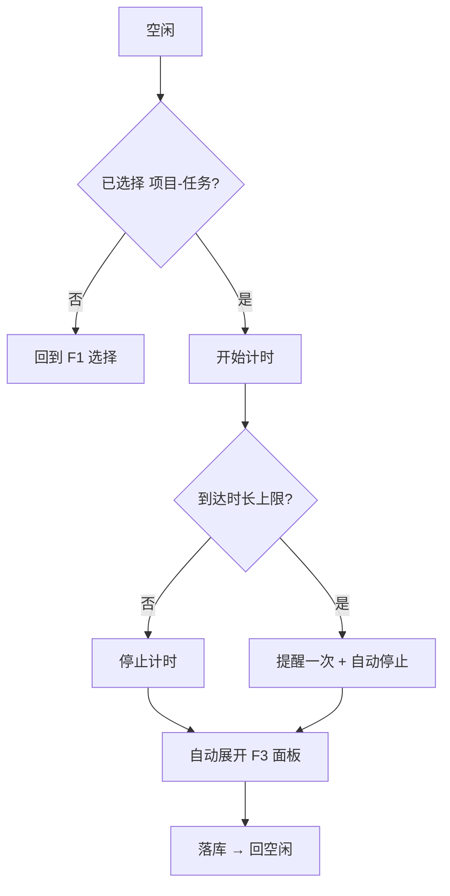
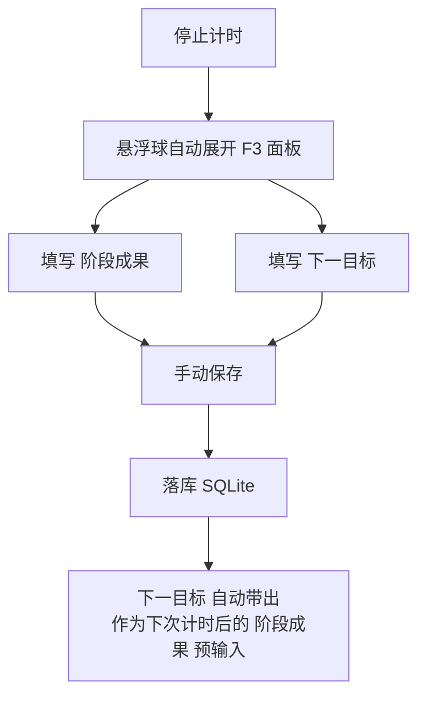
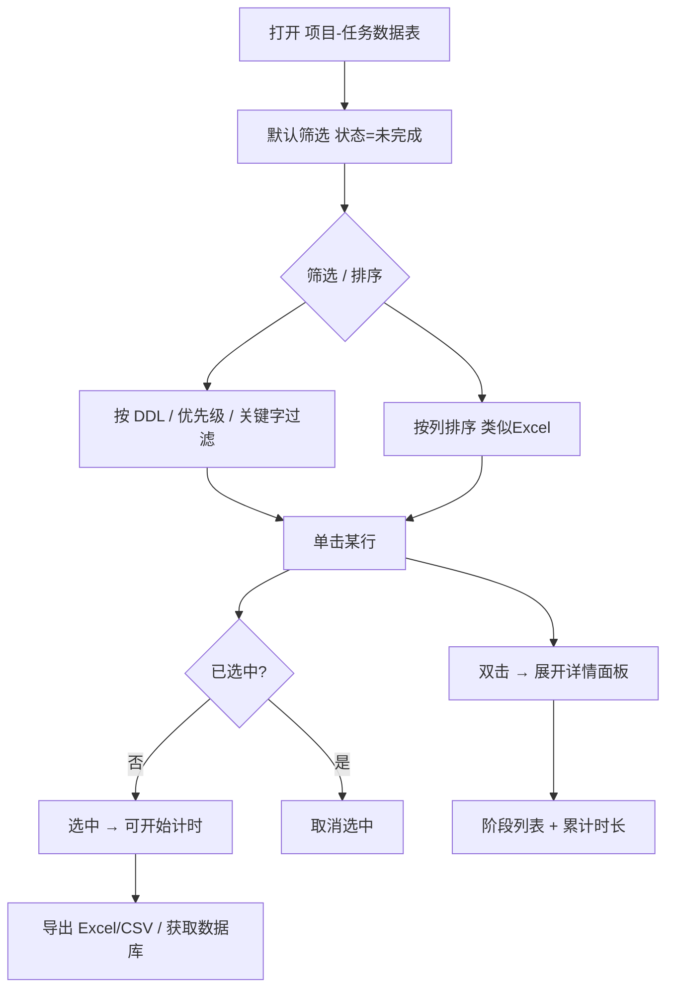
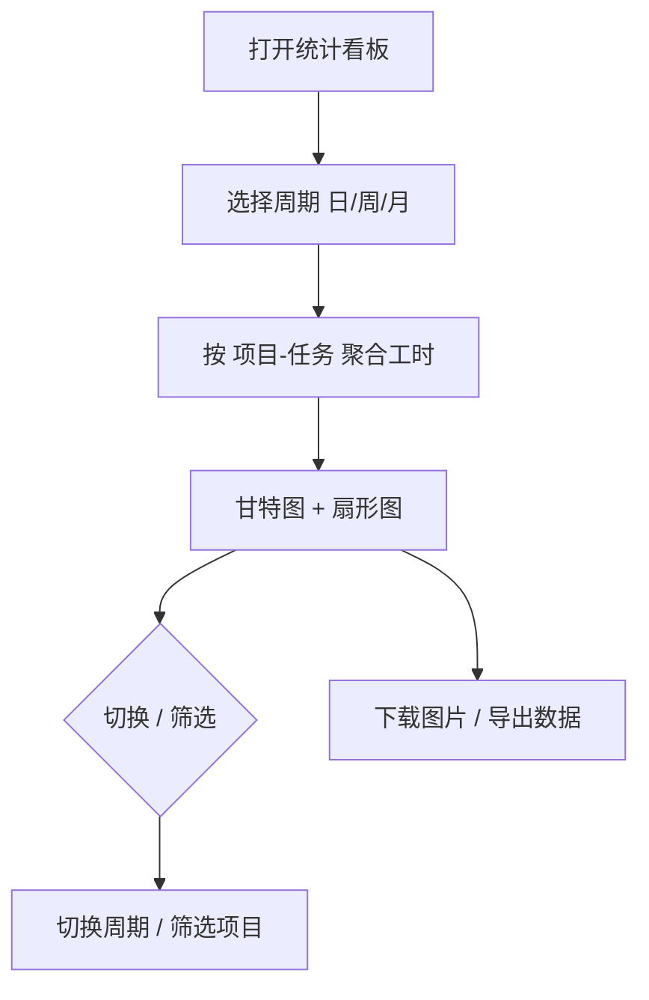
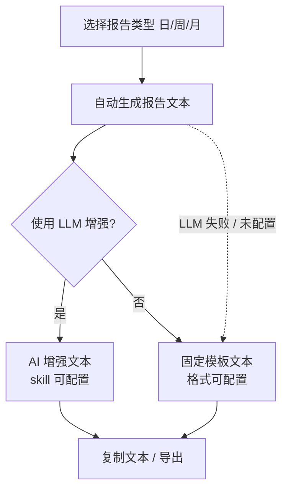

# workLog


***

文档信息：workLog 基本产品设计文档

文档版本：v0.19

创建时间：2026-10-13

状态：草稿 2（需求概述已完成）

编写人：杨与桦

编写完成日期：

评审人：

评审完成日期：


***

# 文档版本历史


| edition | date       | writer | content                                                 |
| ------- | ---------- | ------ | ------------------------------------------------------- |
| v0      | 2026-10-13 | 杨与桦    | 新建基本产品设计文档                                              |
| v0.1    | 2026-10-14 | 杨与桦    | 补充需求概述章节；确定产品形态（悬浮球常驻计时）与技术选型讨论结论                       |
| v0.2    | 2026-10-14 | 杨与桦    | 补充产品描述章节（名词解释、整体流程图、功能清单）                               |
| v0.3    | 2026-10-16 | 杨与桦    | 补充功能需求章节（F1-F6）；新增待办功能并入记录与待办中心（F4）；补充项目 - 任务字段说明       |
| v0.4    | 2026-10-17 | 杨与桦    | 产品整体流程拆分为两条业务主线（项目 - 任务记录 / 统计与日志输出）；功能清单分两组；功能需求补齐验收标准 |
| v0.5    | 2026-10-17 | 杨与桦    | 依据「数据统计与日志导出」流程图更新文字描述、功能清单第二组及 F5/F6 功能需求              |
| v0.6    | 2026-10-18 | 杨与桦    | 联合主键调整为【项目号-任务号-阶段号】；F1 默认字段扩充并支持自定义；F2 改为开始/停止两态（去暂停/快捷键）；F3 下一目标自动预输入；F4 改为项目-任务数据表；F5 归组按自然周/月起点 |
| v0.7    | 2026-10-18 | 杨与桦    | 功能需求章节重构：每个功能小节统一按「场景描述 / 流程图 / 原型（文字线框）/ 详细描述 / 验收标准」组织撰写 |
| v0.8    | 2026-10-18 | 杨与桦    | 补充并整理「页面原型」章节文字；基于该章节制作可交互 HTML 原型（记事板风格） |
| v0.9    | 2026-10-18 | 杨与桦    | 原型改为低保真黑白线框；按钮纯图标（齿轮）；主面板固定纵向 A4 尺寸；表格可滚动并新增项目名筛选；选中改为固定位置滚动（非重排）；双击打开详情；上滑面板底边平齐；汇总页隐去新建按钮 |
| v0.10   | 2026-10-18 | 杨与桦    | 修复双击不触发面板的 bug（单击不再重建 DOM）；交互改为：单击仅选中，双击才滚动至表头并打开详情面板 |
| v0.11   | 2026-10-18 | 杨与桦    | 修复选中行被右移（改用首格 inset 色条）；设置面板顶端改为紧贴标签栏下方；停止计时时当前项目行推至顶端并展开详情 |
| v0.12   | 2026-10-18 | 杨与桦    | 加宽计时态悬浮块、改善上下间距；新增：关闭面板后数据表自动归位（底部仅留一行空行）、点击面板外部即关闭、再次点击新建/设置按钮即关闭 |
| v0.13   | 2026-10-18 | 杨与桦    | 悬浮块改为单行（计时态横向加宽并平滑过渡）；外部点击只关闭、不触发底层；关闭后复原原滚动位置；常规滚动上限为底部两个空行 |
| v0.14   | 2026-10-18 | 杨与桦    | 悬浮块改为两行（按钮/状态/时分一行，项目任务一行），宽度随内容自适应；时间仅显示时分，秒用底边 60 秒进度细线；外部点击拦截 mousedown，修复筛选下拉仍被触发 |
| v0.15   | 2026-10-18 | 杨与桦    | 计时中锁定项目（禁止切换计时对象）；秒的表达改为「工作中」后三个圆点依次闪烁（移除 60 秒进度细线） |
| v0.16   | 2026-10-18 | 杨与桦    | 初始态仅显示悬浮块；点击夹子空白区平滑展开/收起主面板；长按可拖动整个单元（鼠标+触摸） |
| v0.17   | 2026-10-18 | 杨与桦    | 拖动改为按下不释放并移动即触发（去除长按等待）；点击（按下后松开、未移动）展开/收起 |
| v0.18   | 2026-10-19 | 杨与桦    | 计时中允许双击本项目查看详情；停止计时后悬浮块恢复紧凑尺寸；presentDetail 兜底打开已收起的板子 |
| v0.19   | 2026-10-19 | 杨与桦    | 删去筛选行，数据默认最新在前；筛选/排序收纳到字段栏（项目名/优先级/状态筛选，DDL 三态排序）；新建改为顶部空白行、仅保存；停止后阶段记录改为模态、必须手动保存 |

# 需求概述

### 产品概述及目标

**背景**：日常工作中，项目与任务的投入时间分散、缺乏可靠的记录手段，导致写日报、周报和月度工作复盘时需要回忆与手工整理，效率低且数据不准。

**产品定位**：workLog 是一款跨平台（macOS / Windows）桌面端工作记录工具，以常驻悬浮球为交互载体，核心链路为：选择项目与任务 → 启动计时（开始 / 停止） → 结束计时并落库。基于本地积累的结构化计时数据，通过大语言模型（LLM）一键生成日报、周报与月报。

**目标与价值点**：


1. **低成本记录**：计时操作收敛在悬浮球上完成，不打断工作流；

2. **数据可信**：时长由计时器客观产生，杜绝日报靠回忆；

3. **报告提效**：日报 / 周报 / 月报由 LLM 基于真实统计数据自动撰写，用户仅需一键生成与复制；

4. **数据私有**：工作数据仅存本地 SQLite，是否上传由用户自行配置的 LLM 服务决定。

### 文档阅读对象


| 阅读对象     | 职责与关注点                         |
| -------- | ------------------------------ |
| 产品 / 编写人 | 需求定义、优先级判断、验收标准确认              |
| 开发人员     | 理解产品全貌、数据模型与功能细节，据此拆解任务与排期     |
| 评审人员     | 评审需求合理性、完整性与可行性，评审后对风险条款进行确认周知 |

### 运营环境


| 环境项    | 说明                                                 |
| ------ | -------------------------------------------------- |
| 客户端    | macOS 12+ / Windows 10+，桌面端，支持悬浮球常驻、系统托盘           |
| 技术框架   | Tauri 2（Rust 后端 + WebView 前端），非 Electron、非原生双端     |
| 数据存储   | 本地 SQLite 数据库，无云端同步、无服务端依赖                         |
| LLM 服务 | 用户自行配置的 OpenAI 兼容接口（Base URL / API Key / 模型名），云端调用 |
| 网络     | 仅报告生成时需要联网（调用 LLM 接口），日常计时与统计完全离线                  |
| 运行形态   | 单机单用户，无账号体系、无多端同步                                  |

### 产品风险


| # | 风险项                    | 影响与应对                                                               |
| - | ---------------------- | ------------------------------------------------------------------- |
| 1 | 工作数据经 LLM 接口上传云端       | 存在隐私顾虑；应对：仅上传用户选定范围的统计数据、发送前明确提示，且 LLM 服务完全由用户自行配置                  |
| 2 | API Key 存储安全           | 首版明文存于本地配置文件，存在泄露风险；后续版本迁移至系统钥匙串 / 凭据管理器                            |
| 3 | 悬浮球技术可行性               | 透明置顶窗口在 macOS/Windows 存在已知差异（全屏覆盖、边缘渲染）；已验证 Tauri 2 能力，需在开发期实测两平台表现 |
| 4 | 产品交互形态未定               | 悬浮球展开形式、是否保留主窗口尚待讨论确定；应对：开发按 “数据层与计时核心先行、UI 层可替换” 推进，控制返工风险         |
| 5 | LLM 生成质量不稳定            | 报告可能不符合预期；应对：内置报告模板约束输出格式，支持重试与人工编辑                                 |
| 6 | 忘记停止计时                 | 产生虚高时长；应对：单次计时上限 + 到限提醒与自动停止机制                                      |
| 7 | Windows WebView2 运行时依赖 | 个别机器可能未安装；应对：安装包检测并引导安装                                             |

# 产品描述

### 名词解释


| 术语            | 说明                                   |
| ------------- | ------------------------------------ |
| 项目（Project）   | 一项独立工作的集合，每个项目拥有唯一「项目号」，如 P001       |
| 任务（Task）      | 项目下的具体工作事项，在项目内拥有唯一「任务号」，如 T01       |
| 项目 - 任务（维度）    | 一项独立工作；以「项目号 - 任务号」唯一标识，含 DDL、优先级、状态等属性 |
| 阶段（明细 / 联合主键）  | 一次「开始计时 → 停止计时」的独立计时区间，阶段号在该项目 - 任务内自动递增（第 1 次计时 = 阶段 1）；含起止时间、时长、阶段成果与下一目标 |
| 归档            | 项目或任务已完成、不再计时，但历史记录保留可查              |
| 悬浮球           | 常驻桌面、全局置顶的计时交互载体，支持收起 / 展开           |
| 日报 / 周报 / 月报  | 按日 / 周 / 月聚合工时并组织成文的汇报产物             |
| LLM 报告        | 调用用户自配的 OpenAI 兼容接口，基于统计自动撰写的文字报告    |

### 产品整体流程

产品整体流程分为两条业务主线：先「项目 - 任务记录」（工时记录），再基于记录数据「统计与日志输出」。

**1. 项目 - 任务记录业务流程（工时记录）**

用户从空闲状态进入：判断本地是否已有项目 → 新建或选择项目 → 启动项目工作 → 填写阶段成果 → 保存落库 → 回到空闲；期间可继续当前项目或取消项目选择后再选项目。具体流转以流程图为准：


**2. 数据统计与日志导出流程**

基于已落库的工作记录数据，并行提供三条能力：查看项目数据及项目细节并导出 Excel / 获取数据库 → 工时分配统计看板（甘特 / 扇形）并下载图片 / 数据 → 日志 / 周报 / 月报自动生成（固定模板文本（可配置格式）或 AI 增强文本（可配置 skill））并复制文本。具体流转以流程图为准：


### 功能清单

功能清单按两大业务流程拆分为两组，与「产品整体流程」一一对应。

**第一组・工时记录类（对应「项目 - 任务记录业务流程」）**


| 编号 | 功能        | 说明                                                           |
| -- | --------- | ------------------------------------------------------------ |
| F1 | 项目 - 任务管理 | 新建、历史复用（下拉 / 搜索）、自动编号【项目号】-【任务号】-【阶段号】，支持填写项目 - 任务信息并可自定义字段          |
| F2 | 计时核心      | 选择任务后，悬浮控件开始 / 停止计时、防遗忘（时长上限提醒 / 自动停止）                              |
| F3 | 工作内容记录    | 停止计时自动展开面板，填写阶段成果与下一目标；下一目标自动作为下次阶段成果的预输入                        |
| F4 | 项目 - 任务数据表 | 查看器 + 计时对象选择：数据表（项目 - 任务 / DDL / 优先级 / 状态，可筛选排序，默认仅未完成）；单击选中可计时、双击查看详情；支持导出 Excel/CSV |

**第二组・统计输出类（对应「数据统计与日志导出流程」）**

> 说明：流程图第一分支「查看项目数据及项目细节 → 导出 Excel / 获取数据库」由 F4 的数据查看与导出能力承接。


| 编号 | 功能       | 说明                                                        |
| -- | -------- | --------------------------------------------------------- |
| F5 | 工时分配统计看板 | 日 / 周 / 月工时分配统计，甘特 / 扇形图，可下载图片 / 导出数据                     |
| F6 | 报告生成     | 日志 / 周报 / 月报自动生成；固定模板文本（可配置格式）或 AI 增强文本（可配置 skill），复制文本输出 |

# 功能需求

### F1 项目 - 任务管理

**1. 场景描述**

用户开始任何一项工作前，需要先选定或创建「项目 - 任务」作为本次计时的归属；项目、任务长期积累后数量变多，需要能快速复用历史任务，而不是反复手动录入。

**2. 流程图**



**3. 原型（文字线框）**

新建 / 选择界面：

```
┌──────────────────────────────────────────────┐
│  项目-任务管理                            [+新建] │
├──────────────────────────────────────────────┤
│  项目名     [ 交通仿真平台二期           ▾ 搜索 ] │
│  任务名     [ 轨迹数据处理               ▾ 搜索 ] │
│  优先级     [ 高 ▾ ]  截止日期(DDL)[ 2026-11-30 ]│
│  状态       [ 未完成 ▾ ]                        │
│  备注       [________________________________] │
│  ────────────────────────────────────────────  │
│  历史任务：                                     │
│    ▸ P001-T01 轨迹数据处理   [选中 → 带入上一目标]│
│    ▸ P001-T02 模型训练                          │
│                                               │
│            [ 保存并计时 ]       [ 取消 ]        │
└──────────────────────────────────────────────┘
```

**4. 详细描述**

- **数据模型（两层）**：区分「项目 - 任务」维度与「阶段」明细 —— 项目 - 任务是统计与记录的核心维度，阶段是每次独立计时（开始 → 停止）的明细，联合主键为【项目号】-【任务号】-【阶段号】；
- **字段说明（默认字段）**：

| 字段        | 类型        | 说明                              |
| --------- | --------- | ------------------------------- |
| 项目号       | INT       | 项目唯一编号，用户可命名或自动生成（如 1）          |
| 任务号       | INT       | 项目内唯一编号，自动递增（如 1）               |
| 项目名       | TEXT      | 项目名称，如「交通仿真平台二期」                |
| 任务名       | TEXT      | 任务名称，如「轨迹数据处理」                  |
| 状态        | ENUM      | 未完成 / 已完成；默认仅显示未完成，完成后不再进入计时选择 |
| 优先级       | ENUM      | 高 / 中 / 低                        |
| 截止日期（DDL） | DATE      | 项目 / 任务的计划截止时间                  |
| 创建时间      | DATETIME  | 该条目首次创建时间                       |
| 最近使用时间    | DATETIME  | 最近一次计时时间，用于排序与筛选                |
| 累计时长      | TIMESTAMP | 由关联阶段记录聚合得出，非手工录入              |
| 阶段号       | INT       | 该项目 - 任务内的阶段自增序号（第 1 次计时 = 阶段 1） |
| 阶段成果      | TEXT      | 本阶段计时结束时的产出（本次成果）               |
| 下一目标      | TEXT      | 本阶段尚未完成的内容，将作为下一阶段成果的预输入       |

> 以上为默认字段；用户可在「设置」中自定义新增字段，以增加项目记录的信息丰富度。

- **联合主键**：【项目号】-【任务号】-【阶段号】唯一标识一次计时记录；
- **编号规则**：项目号用户可命名或自增，任务号在项目内自动递增，阶段号在项目 - 任务内自动递增（每次计时 +1）；
- **历史复用**：输入界面提供下拉 + 模糊搜索，可直接选中历史项目 - 任务继续计时；
- **待办带入**：选中历史任务时，自动带出该任务上一个阶段的「下一目标」，作为本次阶段成果的预输入（与 F3 联动）；
- **状态流转**：任务完成后可标记为「已完成」，默认不再出现在计时选择列表，历史记录与统计保留。

**5. 验收标准**

- 可新建 / 编辑项目与任务，保存后立即生成【项目号】-【任务号】且不重复；
- 每次停止计时自动生成新阶段，阶段号在该项目 - 任务内自动递增且不重复；
- 输入界面可下拉并模糊搜索历史项目 - 任务，选中后直接带入继续计时；
- 选择历史任务时自动带出上个阶段「下一目标」作为本次成果预输入；
- 状态可标记为「已完成」，完成后不再出现在默认计时选择列表，历史记录与统计保留可查；
- 用户可在设置中自定义新增字段。

### F2 计时核心（悬浮球）

**1. 场景描述**

用户需要在不停下手头工作的情况下，随时开始一段工作计时并在结束时停止；计时全程收敛在悬浮球上完成，不打断工作流。

**2. 流程图**



**3. 原型（文字线框）**

悬浮球（收起 / 展开-空闲 / 计时中）：

```
 收起态            展开态（空闲）           计时中
┌─────┐          ┌──────────────┐     ┌──────────────┐
│ ●录 │          │ ●  空闲        │     │ ●  工作中      │
└─────┘          │ 项目-任务 [▾]  │     │ P001-T01      │
                 │ [开始计时]     │     │ ⏱ 00:34:12    │
                 └──────────────┘     │ [停止]         │
                                      └──────────────┘
```

**4. 详细描述**

- **两态模型**：仅「开始 / 停止」两种状态，不提供暂停 / 继续；每次计时即一条连续区间，中断时通过「停止 → 重新开始」自然拆成多段；
- **操作顺序**：先选择项目 - 任务、再开始计时，停止时自动展开 F3 面板填写阶段成果；
- **单任务计时（首版）**：同时只进行一个计时，防止时长口径错乱；多任务并计作为后续增强；
- **计时中锁定项目**：计时进行中禁止切换计时对象——单击其他数据行不改变选中，双击其他行不展开详情，均提示「计时中，无法切换项目」；但**允许双击本项目**查看其详细信息；
- **停止后恢复**：停止计时后悬浮块恢复为空闲时的紧凑尺寸（收起项目任务行）。
- **防遗忘**：单次计时设置时长上限（默认可配置，如 4 小时）——接近上限（如前 15 分钟）系统提醒一次，达到上限自动停止并展开 F3 面板（对应风险表 #6）；
- **计时精度**：按秒累计；跨午夜记录归入开始时间所在日。

**5. 验收标准**

- 选择项目 - 任务后可开始计时，停止后自动生成一个阶段记录；
- 不提供暂停 / 继续；任意时刻仅存在一个进行中的计时（首版）；
- 计时中单击其他行 / 双击其他行均无法切换计时对象，并有提示；双击本项目可查看详情；
- 停止计时后悬浮块恢复紧凑尺寸；
- 单次计时接近上限时提醒一次，达到上限自动停止并展开面板；
- 跨午夜记录归入开始时间所在日。

### F3 工作内容记录（阶段成果与下一目标）

**1. 场景描述**

停止计时后，用户需要记录本阶段的实际产出与尚未完成的内容，以便后续复盘与生成报告。

**2. 流程图**



**3. 原型（文字线框）**

停止计时后展开的小面板：

```
┌────────────────────────────────┐
│  本次阶段记录          P001-T01 │
│────────────────────────────────│
│  本次时长   2 小时 32 分钟       │
│  阶段成果（可留空）              │
│  [完成轨迹数据处理框架搭建        ]│
│  下一目标（可留空）              │
│  [验证数据集，训练 baseline 模型  ]│
│                                │
│                         [ 保存 ]│
└────────────────────────────────┘
```

**4. 详细描述**

- **自动展开（模态）**：停止计时后自动上滑「本次阶段记录」面板，展示项目-任务、本次时长（只读），并引导填写「阶段成果」与「下一目标」；
- **必须手动保存**：阶段成果与下一目标均可留空，但**必须手动点击「保存」**——面板为模态，无关闭按钮、外部点击不关闭，保存前不能返回主面板、新建、设置或开始计时；
- **下一目标预输入**：上一阶段的「下一目标」会自动作为本次「阶段成果」的预输入（与 F1 待办带入联动）；
- **数据落库**：阶段成果与下一目标随本阶段记录一并写入 SQLite。

**5. 验收标准**

- 停止计时后自动展开「本次阶段记录」模态面板；
- 阶段成果与下一目标可留空，但必须手动点击保存；未保存前其他操作（返回 / 新建 / 设置 / 开始计时）均不可用；
- 上一阶段的「下一目标」会在本次「阶段成果」中自动预输入。

### F4 项目 - 任务数据表（查看器 + 计时对象选择）

> 说明：本模块作为「查看器 + 计时对象选择表单」，以一张数据表集中展示项目 - 任务，用于查看、筛选、排序并选择当前要计时的对象。

**1. 场景描述**

用户需要从全部项目 - 任务中快速找到并选中本次要计时的对象，同时能查看基本信息并导出完整数据。

**2. 流程图**



**3. 原型（文字线框）**

```
┌──────────────────────────────────────────────────────┐
│  项目-任务数据表                              [导出][DB] │
│──────────────────────────────────────────────────────│
│  状态:[未完成▾]  优先级:[全部▾]  搜索:[___________]      │
│──────────────────────────────────────────────────────│
│  ▣ 项目-任务       │ DDL        │ 优先级 │ 状态  │      │
│  ───────────────────────────────────────────────────  │
│  ▶ P001-T01 轨迹   │ 2026-11-30 │ 高    │ 未完成 │(选中)│
│  ▢ P001-T02 模型   │ 2026-12-05 │ 中    │ 未完成 │      │
│  ▢ P002-T01 文档   │ 2026-11-20 │ 低    │ 未完成 │      │
│  ...                                            │      │
│  ───────────────────────────────────────────────────  │
│  双击展开详情：阶段列表(起止/时长/成果/下一目标) + 累计时长 │
└──────────────────────────────────────────────────────┘
```

**4. 详细描述**

- **展示列**：仅展示「项目 - 任务」「DDL」「优先级」「状态」四个字段，样式类似 Excel，支持按列排序与条件筛选；
- **默认筛选**：默认只显示「状态 = 未完成」的项目 - 任务，以减少选择项；可手动切换查看全部（含已完成）；
- **单击选中**：单击某行即选中该「项目 - 任务」作为当前计时对象（可开始计时）；再次单击同一行取消选中；
- **双击详情**：双击某行展开该「项目 - 任务」的详细信息面板，展示其阶段列表（各阶段起止、时长、阶段成果、下一目标）与累计时长等；
- **导出**：支持一键导出当前数据为 Excel（.xlsx）与 CSV，字段与记录一致；
- **获取数据库**：提供「直接查看数据库」高级入口（工程师友好）。

**5. 验收标准**

- 数据表仅展示项目 - 任务 / DDL / 优先级 / 状态四列，支持按列排序与条件筛选；
- 默认仅显示「未完成」项目，可切换查看全部；
- 单击某行选中为计时对象，再次单击取消选中；
- 双击某行可展开详细信息面板（阶段列表 + 累计时长等）；
- 可一键导出 Excel / CSV，并提供直接查看数据库入口。

### F5 工时分配统计看板

**1. 场景描述**

用户需要从宏观上了解各项目、任务在不同周期内的工时投入分布。

**2. 流程图**



**3. 原型（文字线框）**

```
┌────────────────────────────────────────────────────┐
│  工时分配统计看板                                     │
│  周期:[本周▾]  项目:[全部▾]        [下载图片][导出数据] │
│────────────────────────────────────────────────────│
│  甘特图                                             │
│  P001-T01 ▓▓▓▓▓▓░░░░░░░░░░  5h                    │
│  P001-T02 ░░▓▓▓░░░░░░░░░░░  3h                    │
│  P002-T01 ░░░░▓▓░░░░░░░░░░  2h                    │
│────────────────────────────────────────────────────│
│  扇形图（占比）                                      │
│      ██ P001-T01  50%                              │
│      ██ P001-T02  30%                              │
│      ██ P002-T01  20%                              │
└────────────────────────────────────────────────────┘
```

**4. 详细描述**

- **统计粒度**：支持日 / 周 / 月三级，按项目维度汇总工时分配；
- **图表形态**：使用「甘特图 + 扇形图」展示工时分配 —— 甘特图按项目 - 任务横向呈现各周期时长，扇形图呈现占比；
- **归组口径**：周维度按自然周（周一起点）、月维度按自然月（每月 1 日起点）归组；记录按开始时间归入对应自然周期，跨周期记录归入开始时间所在周期；
- **图片 / 数据导出**：看板可下载为图片，统计结果与图表数据均可导出。

**5. 验收标准**

- 支持日 / 周 / 月三级统计，按项目 - 任务分组展示工时分配；
- 以甘特图 + 扇形图呈现，可切换周期与项目筛选；
- 周 / 月按自然周期起点（周一 / 每月 1 日）归组，跨周期记录归入开始时间所在周期；
- 看板可下载图片，统计结果与图表数据可导出。

### F6 报告生成

**1. 场景描述**

用户需要快速得到可提交的日报 / 周报 / 月报，而不是手工回忆整理。

**2. 流程图**



**3. 原型（文字线框）**

```
┌───────────────────────────────────────────────┐
│  报告生成                                       │
│  类型:[月报▾]  周期:[2026-10▾]                  │
│  使用LLM增强: [✔]  skill:[默认报告增强▾]        │
│───────────────────────────────────────────────│
│  [生成报告]                                     │
│  报告预览：                                     │
│  ┌───────────────────────────────────────────┐│
│  │ 2026年10月 工作报告                        ││
│  │ 一、本月投入：共 62h，集中于 P001-T01...   ││
│  │ 二、主要产出：...                          ││
│  │ 三、下月计划：...                          ││
│  └───────────────────────────────────────────┘│
│       [复制文本]  [导出]  [重新生成]            │
└───────────────────────────────────────────────┘
```

**4. 详细描述**

- **报告类型**：日志（日报）、周报、月报自动生成；
- **生成判断**：是否使用 LLM 增强由用户选择 —— 选「是」生成 AI 增强文本（skill 可配置），选「否」生成固定模板文本（输出格式可配置）；
- **模板约束**：内置固定模板约束输出结构，保证格式稳定；LLM 增强仅做内容润色，接口由用户自配 OpenAI 兼容服务；
- **输出方式**：文本生成后支持一键复制与导出；
- **失败兜底**：LLM 调用失败或无配置时，回退到固定模板结果，可人工编辑（对应风险表 #5）。

**5. 验收标准**

- 可一键生成日志 / 周报 / 月报；
- 可选择使用 / 不使用 LLM 增强：AI 增强文本的 skill 可配置，固定模板文本的格式可配置；
- 未配置 LLM 或调用失败时回退到固定模板结果；
- 生成文本支持一键复制，并可导出。

# 页面原型

> 本阶段先交付**低保真黑白线框原型**（`试验品/WorkLog页面原型.html`，可用浏览器直接打开交互）。

## 基本风格

整体采用拟物化的「记事板」设计语言：模拟一块记事板的样貌，但以极简现代风格呈现，而非写实风格。记事板的「夹子」由常驻悬浮球承担，软件主面板即记事板的「底板」。低保真阶段全部以黑白线框呈现，仅表达结构与交互，不涉及配色与材质。

## 初始态与展开 / 收起

- **初始态**：软件启动后仅显示悬浮块（夹子），主面板（板子）隐藏；
- **点击展开 / 收起**：点击悬浮块的**空白区（非启停按钮）**，主面板由夹子位置平滑展开（板子从夹子下伸出，上边缘与夹子中部重叠）；再次点击悬浮块则平滑收起；
- **收起联动**：收起时一并关闭所有上滑面板；
- **拖动**：在悬浮块上**按下不释放并移动**，即拖动整个「夹子 + 板子」单元在屏幕上的位置；按下后直接松开（未移动，即点击）则触发展开 / 收起；
- 展开 / 收起与拖动均支持鼠标与触摸。

## 悬浮球

悬浮球是软件的基本入口，为一个圆角矩形，宽度随当前【项目 - 任务】宽度自适应。

- **空闲态**：仅一行，显示启停按钮与「空闲」，宽度紧凑；
- **计时态**：展开为两行——
  - 第一行：启停按钮 + 「工作中」+ 计时（仅显示**时 : 分**，如 00:00）；
  - 第二行：当前【项目 - 任务】；
- **秒的表达**：不显示秒数字，以「**工作中**」后**三个圆点依次闪烁**（追逐式明暗，循环）表示正在走动；
- **计时中锁定项目**：计时进行中，单击其他行 / 双击其他行均不改变计时对象（提示「计时中，无法切换项目」）；但**允许双击本项目**查看详情；
- **停止后恢复紧凑**：停止计时后，悬浮块收起项目任务行、恢复空闲时的紧凑尺寸；
- 启停按钮内圆点由圆形平滑变为方形；空闲↔计时的宽度、高度与圆点变化均以平滑过渡呈现。

## 主面板

- **固定尺寸**：主面板采用纵向 A4 长宽比（1 : 1.414），尺寸固定不随内容伸缩；
- 主面板上边缘位于悬浮球中央水平线位置；
- 顶栏左右两侧分别为「新建项目 - 任务」与「设置」两个**纯图标按钮**（无文字）：新建为「＋」，设置为齿轮；
- 悬浮球下方为两栏标签项：「任务」与「汇总」；
- 两个标签页共用同一固定尺寸区域，切换时面板大小不变。

## 上滑面板（统一交互）

项目详情、新建项目、设置均以「上滑面板」呈现，统一遵循：

- **点击外部关闭**：面板出现后，点击剩余主面板的任意位置（面板、按钮以外）即关闭；此时该点击**仅用于关闭**，不会触发底层任何选项（筛选下拉、过滤、选中、排序、切标签等均不生效，含下拉框在按下瞬间展开）；
- **再次点击按钮关闭**：再次点击「新建项目 - 任务」或「设置」按钮，关闭对应面板；
- **关闭后数据表复原**：关闭面板时，数据表滑动**复原到打开面板之前的滚动位置**（而非默认位置）。

## 任务标签页

任务标签页包含「数据表」与「项目信息查看」两种情形：

### 数据表

- 采用类数据表样式，表格区域固定高度，可**滚轮纵向滚动**查看更多数据；
- **不再设置独立筛选行**；数据**默认按追加顺序显示、最上方为最新**（按创建时间倒序）；
- **字段**：项目名、任务名、DDL、优先级、状态；
- **筛选 / 排序功能统一收纳在字段栏（表头）字段名后方**：
  - **项目名**：仅支持筛选——字段名后跟一个倒三角（▾），点击展开下拉列表（含「全部」+ 各项目名，**默认按 A-Z 排序**）；
  - **任务名**：不挂任何筛选 / 排序功能；
  - **DDL**：支持排序——点击在「未排序 → 升序 → 降序 → 未排序」三态循环，点第三次恢复未排序原貌（箭头标识 ↑/↓）；
  - **优先级**：仅支持筛选（▾，全部 / 高 / 中 / 低）；
  - **状态**：仅支持筛选（▾，全部 / 未完成 / 已完成）；
- 数据行下方保留若干空白行（类似电子表格，提供滚动区间）；**常规浏览时最多滚动到「底部两个空行」**，不会继续滚到整页空白。

### 项目信息查看

- **单击某行**：仅选中该行——该行高亮标出，最左侧显示一条状态色长条，长条高度与数据行高度一致；不滚动、不展开；
- **双击某行**：在选中基础上，将该行在固定位置滚动至「与字段栏（表头）接触」的位置（即该行成为表头下方的当前行，不重新排序、不改变数据顺序），同时上滑「项目详细信息」面板；
- 面板上边缘位于「字段栏 + 第一行」之下，不遮挡表头与当前选中行；
- 面板用于查看与修改选中条目的相关信息（不含数据表已展示的字段），含阶段列表、累计时长等；
- 面板底部与主面板底部平齐，无镂空；面板底部为「保存」按钮，右上为「关闭（收回）」按钮。

### 停止计时后的「本次阶段记录」（模态）

- **停止计时后自动弹出**：当前项目数据行被推至字段栏下方，上滑「本次阶段记录」面板（F3）；
- 面板含：项目-任务、本次时长（只读）、**阶段成果**（本次成果）、**下一目标**（待完成）；
- **必须手动点击「保存」**：阶段成果与下一目标均**可留空**，但必须点击保存，期间不能进行其他任何操作（返回主面板、切标签、新建、设置、开始计时）；
- 面板为模态，右上角无关闭按钮、外部点击不关闭；点击保存后恢复正常。

## 汇总标签页

- 切换至汇总标签页时，**顶栏「新建项目 - 任务」按钮隐去**（仅保留设置）；
- 汇总标签页包含「工时分配看板」（甘特 / 扇形）与「报告生成文字框」；
- 区域尺寸与任务标签页一致。

## 新建项目页面

- 点击「新建项目 - 任务」按钮后，在数据表**最上方新增一个空白行**（最新数据位置），并上滑新面板；
- 上滑位置不遮挡字段栏与顶部的空白行；面板用于填写新建项目 - 任务的信息（项目名、任务名、DDL、优先级、备注等）；
- 面板底边与主面板底部平齐，无镂空；
- **底部仅「保存」按钮**（保存即作为最新数据置顶，不再有「保存并计时」）；右上角为关闭按钮。

## 设置页面

- 点击「设置」按钮后，上滑一个新面板，包含软件的各类设置项；
- 面板顶端紧贴「任务 / 汇总」标签栏下方（位置高于详情 / 新建面板，可覆盖筛选区）；
- 面板底边与主面板底部平齐，无镂空。